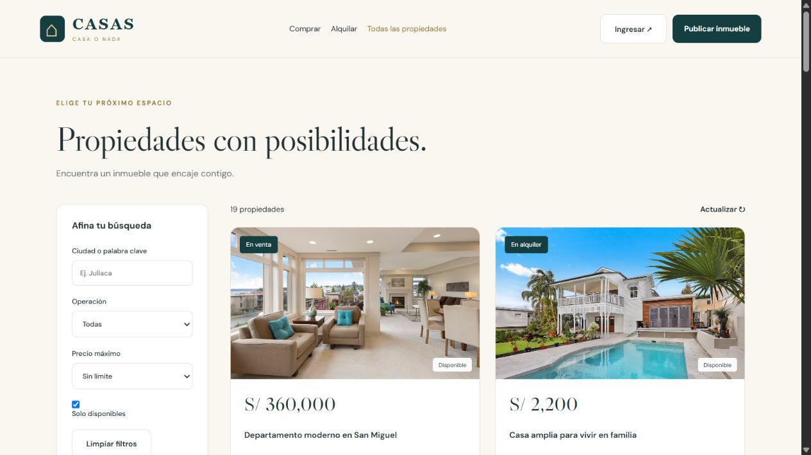
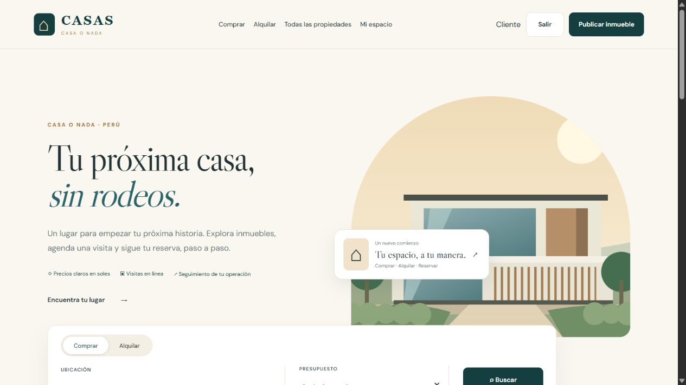
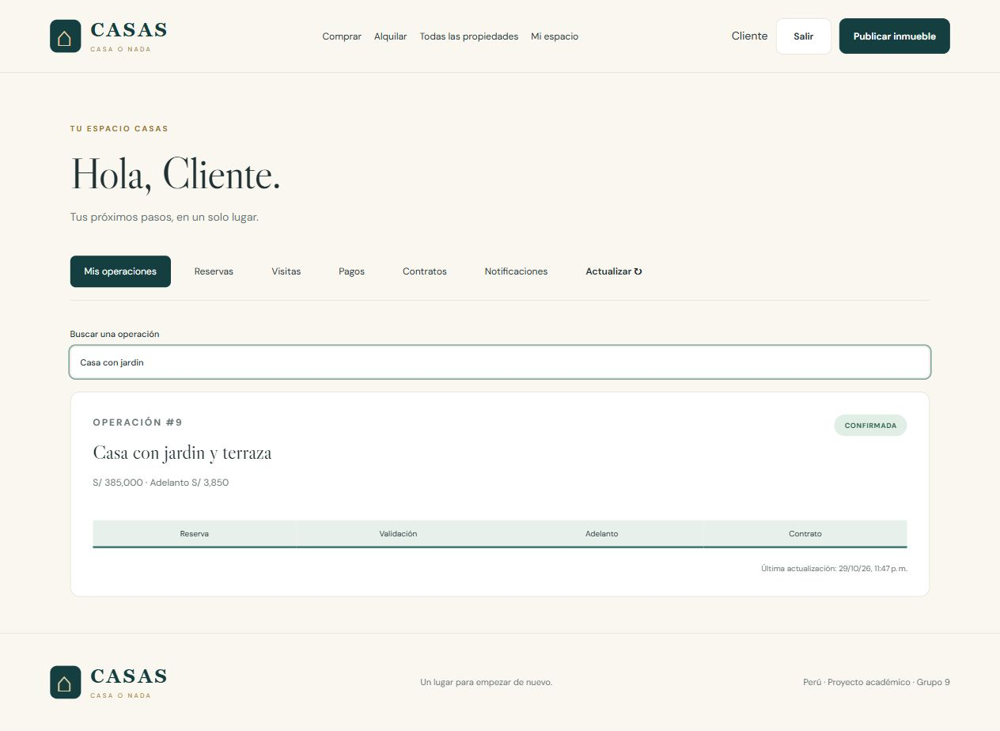
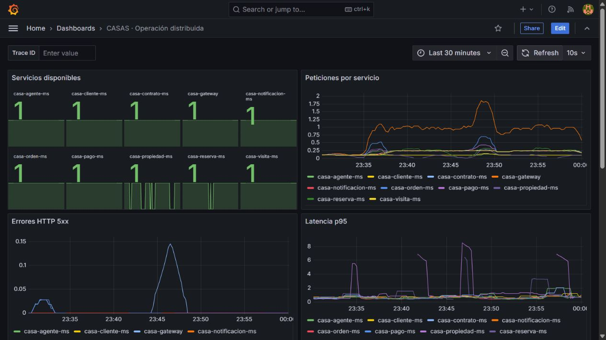
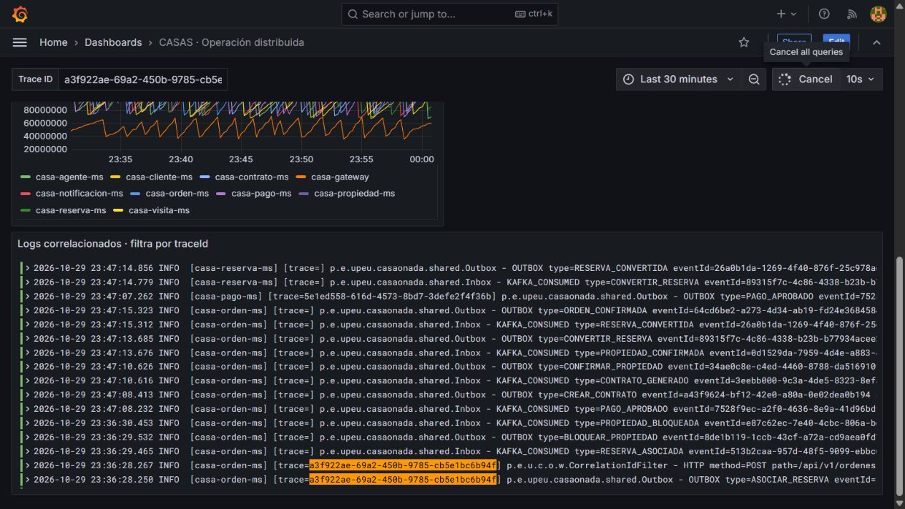

# Evidencias de la entrega

Pruebas ejecutadas entre el 29 y el 30 de octubre de 2026 (hora de Lima). Los archivos JSON conservan marcas de tiempo ISO en UTC; por eso algunas corresponden al día 30 mientras la hora local aún era del día 29.

## Validación final con Docker (30 de octubre)

Se recuperó Docker Desktop conservando volúmenes, se arrancó el Compose propio y se repitieron las pruebas sobre los puertos definitivos de CASAS.

- **Maven normal: BUILD SUCCESS**, trece módulos Java y 78 pruebas sin fallos. [Salida completa](assets/maven-verify.txt) y [resumen JUnit](assets/maven-verify.json).
- **50 comprobaciones HTTP PASS** y seguridad directa en los nueve servicios. Los JSON de la tabla siguiente corresponden a esta última ejecución.
- Caída real de propiedad y recuperación CLOSED → OPEN → HALF_OPEN → CLOSED.
- Reenvío del mismo evento Kafka con un solo contrato y `duplicate=true` registrado por el consumidor.
- **Compose validado**, PostgreSQL y Kafka saludables; Keycloak, Kafka UI, Prometheus, Loki, Alloy y Grafana iniciados.
- [Observabilidad Docker](assets/observabilidad-docker.json): diez aplicaciones disponibles, once archivos de logs recogidos por Alloy y un mismo trace en siete servicios.
- Se cargaron nueve inmuebles ficticios con fotografías ilustrativas y dos agentes. La carga repetida no duplicó registros; el inicio completo ahora la ejecuta automáticamente (opción `-SkipDemoData` para omitirla).

## Resultados

| Comprobación | Resultado | Archivo |
|---|---|---|
| Java / JUnit | 78 pruebas correctas; cero fallos | [Resumen](assets/resultados-unitarios.json) |
| HTTP de negocio y estabilidad | 50 comprobaciones PASS | [Resultados HTTP](assets/resultados-http.json) |
| JWT directo a servicios | 9 servicios; 401 sin token y 403 para cliente en ruta ADMIN | [Seguridad](assets/seguridad-servicios.json) |
| Caída real de propiedad | CLOSED → OPEN → HALF_OPEN → CLOSED | [Resiliencia](assets/resiliencia-real.json) |
| Reproceso del mismo evento Kafka | Duplicado reconocido; un contrato antes y después | [Kafka](assets/reprocesamiento-kafka.json) |
| Migraciones y restricciones SQL | 80 comprobaciones correctas con PostgreSQL embebido | `validation/check-sql.mjs` |
| Catálogo y filtros opcionales | Cuatro consultas HTTP 200, incluido listado sin filtros | [Regresión](assets/catalogo-geocodificacion.json) |
| Servicio externo real | Geocodificación de Juliaca, Puno, Perú | [Respuesta](assets/catalogo-geocodificacion.json) |
| Angular y PKCE | Login real, reserva, pago simulado y orden #9 CONFIRMADA | [Flujo web](assets/flujo-frontend.json) |
| Prometheus, Loki y Grafana | Métricas de diez aplicaciones y logs de once | [Observabilidad](assets/observabilidad.json) |

Después del ajuste de búsqueda y del reintento de lectura se volvieron a compilar propiedad y reserva y se repitieron sus siete pruebas unitarias, sin fallos. La caída real se volvió a verificar con esa configuración.

## Cliente Angular

La portada adapta el prototipo aportado por el equipo. La ilustración es propia del proyecto; no representa una fotografía ni acredita un inmueble real.

La operación #9 nació desde el cliente web y el administrador aprobó el adelanto en el simulador local. El cliente recibió la confirmación por consulta periódica de la API.

## Diagnóstico de varios servicios

El tablero consulta Prometheus y Loki reales. La disponibilidad actual se combina con el historial de caídas provocadas y la latencia observada; no se ocultan los fallos de prueba.

La misma operación conserva el trace `a3f922ae-69a2-450b-9785-cb5e1bc6b94f` en llamadas HTTP y eventos. El filtro de logs permite seguir reserva, orden, pago y contrato.

## Procedencia y límites

El ZIP de backend estabilizado y los prototipos fueron aportados por el equipo. El Git local tenía una versión anterior de seis servicios; se integraron los nueve dominios del ZIP, se añadieron frontend y observabilidad y se corrigió una consulta que enviaba parámetros nulos ambiguos a PostgreSQL.

Las pruebas operativas utilizaron bases exclusivas `casas_u2_*`, un realm `casa-o-nada` y tópicos `casa.*`. No se utilizaron entidades ni tablas de la tarea personal. Para estas comprobaciones se reutilizó el motor local disponible de PostgreSQL/Kafka/Keycloak con configuración temporal, sin convertirlo en la configuración de despliegue del repositorio.

La primera revisión utilizó binarios oficiales y bases de validación separadas. En la validación final se obtuvo acceso al contexto normal de Windows y se ejecutó **el Compose real y Maven verify**; las limitaciones anteriores de esas dos comprobaciones quedaron resueltas. Las capturas iniciales se conservan como antecedentes, y la nueva captura de catálogo corresponde al despliegue final con fotografías.

Docker Desktop presentó un fallo de inicio de sockets temporales. Se preservaron sus directorios de runtime y se recrearon vacíos; no se hizo factory reset ni se borraron volúmenes. Tras recuperar el motor se comprobaron de nuevo PostgreSQL, Kafka, autenticación y el flujo de negocio.

Las capturas son vistas del navegador integrado. No incluyen reloj ni barra de escritorio; los JSON y logs conservan las marcas de ejecución. Las imágenes anteriores del repositorio son antecedentes, no resultados nuevos.

## Pendientes de la presentación

- El equipo debe grabar su video pitch, sustentar y confirmar su aporte real.
- El proveedor final de identidad es Keycloak; no se afirma haber construido un emisor JWT propio.
- Mercado Pago real requiere credenciales y validación del equipo. Los pagos demostrados son simulados; la geocodificación sí consume un servicio externo real.
- El repositorio público no tenía topics al revisarlo. Configurarlos con la sección académica correcta antes de entregar.
- La publicación remota se comprueba mediante el estado del workflow de Pages; una captura local por sí sola no la demuestra.
