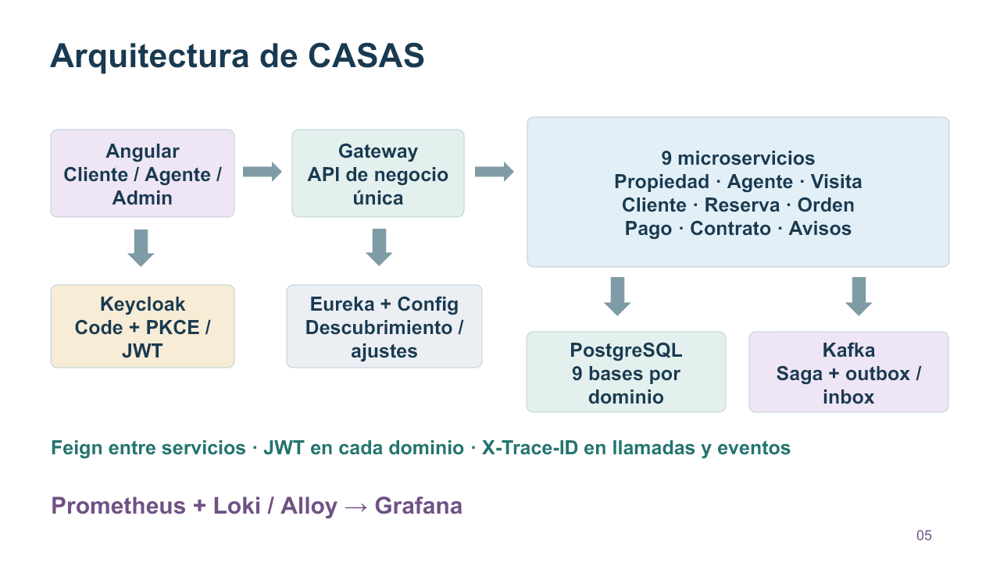

# Sustentación S12 · Jannys y Alanguia

[Descargar PPT visual con BT21](assets/CASAS-Sustentacion-Unidad2-Final.pptx).

[Guion completo para dos expositores, accesos y comandos](guia-demo.md).

Presentar las diapositivas 1–6 y pasar a la aplicación. Las 7–13 son respaldo. Exponen los dos integrantes del grupo; el reparto organiza la exposición y no atribuye autoría individual no verificada. La defensa por integrante sigue siendo un requisito del docente.

