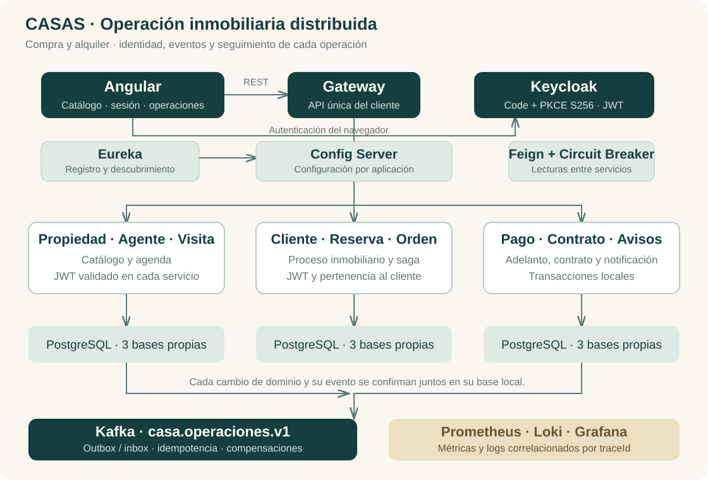

# Producto de Unidad II

**Sistema distribuido seguro, resiliente, consistente, observable e integrado con cliente frontend.**

## Dominio y alcance

CASA O NADA acompaña una operación inmobiliaria: propiedad → visita → reserva → orden → adelanto → contrato → aviso. Se ofrecen compra y alquiler en PEN. La aprobación del adelanto no basta por sí sola: la orden se confirma después de completar contrato, propiedad y reserva.

La versión académica usa pagos manuales (Yape, Plin, transferencia) validados por un agente a partir de la captura, sin pasarela real. Los contratos son registros de negocio; no realizan escritura pública, transferencia SUNARP ni firma digital. Las notificaciones permanecen en el sistema. El adaptador externo de Mercado Pago requiere credenciales y pruebas propias antes de usarse fuera del laboratorio.

## 1. Comunicación síncrona resiliente

[S06](s06.md). Feign consulta servicios por nombre en Eureka. La lectura enriquecida de una reserva conserva su información local cuando propiedad no responde. Las escrituras que necesitan validar disponibilidad se rechazan de manera controlada: no se inventan precios ni se confirma una reserva con información ausente.

## 2. Seguridad distribuida

[S07 y S07b](s07.md). Keycloak autentica; Gateway y los nueve servicios validan firma, emisor y roles. Los permisos de rol se combinan con pertenencia a cliente. El catálogo es público por decisión de producto; reservas, órdenes, pagos, contratos y avisos requieren sesión. `cliente_id` enlaza el sujeto de Keycloak con el identificador de negocio, sin aceptar un cliente arbitrario enviado por la SPA.

## 3. Mensajería asíncrona

[S08](s08.md). Kafka transporta `casa.operaciones.v1`, particionado por saga. Outbox persiste la intención de publicar junto al cambio local; cada consumidor tiene grupo independiente e inbox. Los fallos agotados van a DLT y pueden reintentarse con permisos de administrador.

## 4. Consistencia eventual

[S09](s09.md). La orden persiste el estado de una **saga orquestada**, una decisión propia distinta de la coreografía del ejemplo del docente. Ante un fallo coordina cancelación de contrato, reversión de pago, liberación de propiedad y cancelación de reserva. Los eventos se entregan al menos una vez y el efecto se protege con inbox, restricciones únicas y bloqueos por operación.

## 5. Observabilidad operacional

[S10](s10.md). Actuator expone health y Prometheus; Grafana reúne disponibilidad, tráfico, errores, latencia y memoria. Alloy centraliza archivos en Loki. `X-Trace-ID` atraviesa Gateway, Feign y los eventos para consultar una misma operación en varios servicios.

## 6. Frontend integrado

[S11](s11.md). Angular consume negocio únicamente por Gateway. Keycloak usa Authorization Code + PKCE S256; los tokens viven en memoria. La interfaz distingue cliente, agente y administrador y conserva la protección de servidor aunque se manipule una ruta del navegador.

## Arquitectura

## Correspondencia con la evaluación

| Criterio | Peso | Dónde se verifica |
|---|---:|---|
| Resiliencia | 12% | Caída real de propiedad y recuperación |
| Seguridad | 16% | JWT y permisos en Gateway y servicios directos |
| Mensajería | 16% | Outbox, Kafka y consumo independiente |
| Consistencia | 16% | Pago rechazado, compensación y reprocesamiento |
| Observabilidad | 12% | Panel con dos o más servicios y mismo trace |
| Frontend | 8% | Flujo de reserva y ruta por rol |
| Sustentación | 20% | Demostración y defensa individual |

La ejecución y sus resultados se registran en [Evidencias](evidencias.md). Esta página no asigna una nota ni sustituye las pruebas en vivo.

## Referencias del curso

- [Evaluación S12](https://262dist.github.io/pagatu/sesiones/S12_Evaluacion_Unidad_2/).
- [Plantilla y rúbrica de Unidad II](https://262dist.github.io/pagatu/proyecto-sello/u2-producto/).
- [Repositorio del docente](https://github.com/262dist/pagatu).

## Servicio externo real

El detalle de un inmueble consulta la ciudad por `propiedad-ms` usando la API real de geocodificación de Open-Meteo / GeoNames. Angular solicita esa información únicamente por Gateway y ofrece un enlace al mapa de la ciudad. La consulta tiene timeout y caché de 30 minutos; si falla, la reserva sigue disponible. Las coordenadas son una referencia urbana, no el domicilio del inmueble. La integración se comprobó con Juliaca (Puno, Perú). El adaptador de Mercado Pago conserva su validación externa pendiente.
